# Haven

Greenfield `Next.js` + `Supabase` implementation of the Haven PRD.

## Status

This repository currently contains:

- project scaffold
- PRD-aligned source spec
- Supabase schema scaffold for immigration profiles, timelines, community, and email ingest
- advisor chat route, API surface, trusted-source corpus scaffolding, and conversation persistence schema
- typed Haven domain model and validation schemas
- app shell for onboarding, dashboard, timeline, layoff planner, community, inbox, and settings
- mock repository layer that can be replaced with live Supabase queries

## Local setup

1. Install a Node.js toolchain.
2. Copy `.env.example` to `.env.local`.
   Set `NEXT_PUBLIC_MIXPANEL_TOKEN` as well if you want Mixpanel client analytics enabled.
   Set `NEXT_PUBLIC_POSTHOG_PROJECT_TOKEN` to capture the server-side `signup_completed` activation event; US Cloud uses `NEXT_PUBLIC_POSTHOG_HOST=https://us.i.posthog.com`.
3. Install dependencies with `npm install`.
4. Run `npm run dev`.
5. Verify the app with `npm run typecheck` and `npm run build:webpack`.

If `node` and `npm` are not on your shell `PATH` but the shared local fallback runtime exists at `/tmp/node-v22.14.0-darwin-arm64/bin/node`, you can start the app with `./dev.sh`.

## Supabase setup

1. Create or link a Supabase project.
2. Apply migrations in order:
   - `supabase/migrations/0001_init.sql`
   - `supabase/migrations/0002_advisor.sql`
   - `supabase/migrations/0003_crisis_mode.sql`
3. Seed optional starter data from `supabase/seed.sql`.
4. Configure Auth redirects for `http://localhost:3000`.
5. Regenerate `src/types/database.ts` whenever the schema changes.

## Supabase CLI workflow

The project now includes a local Supabase CLI dependency plus repo-local wrappers:

- `npm run supabase -- --version`
- `npm run supabase:push`
- `npm run supabase:types`
- `npm run supabase:migrations`

The wrappers support two non-interactive setups:

1. `SUPABASE_DB_URL`
   Use this when you want `db push`, `migration list`, and type generation to talk directly to Postgres.
2. `SUPABASE_ACCESS_TOKEN` plus `SUPABASE_DB_PASSWORD`
   The wrappers derive `SUPABASE_PROJECT_REF` from `NEXT_PUBLIC_SUPABASE_URL` if you do not set it explicitly.

Recommended:

- Use `npm run supabase:push` after adding a new file under `supabase/migrations/`.
- Use `npm run supabase:types` after every schema change so `src/types/database.ts` stays in sync.

## Advisor setup

- Signed-in conversations are saved to Supabase (`advisor_threads`, `advisor_messages`). Without Supabase the advisor runs on the demo persona in development and an empty profile in production.
- Set `OPENAI_API_KEY` to enable moderation and model-generated answers. Without it, the advisor falls back to deterministic source-grounded responses from the bundled trusted corpus.
- You do not need `supabase/migrations/0002_advisor.sql` to use the current advisor UI. That migration is for future persisted history, citations, and optional stored source retrieval.
- `POST /api/internal/source-sync` is optional and only needed if you want to seed the Supabase-backed trusted corpus for future storage/retrieval flows.

## How the Advisor works

The Advisor is a **fixed workflow, not an agent**. Code decides every step and the order they run in. The AI is called at three points: checking the message is safe, reading the topic alongside the keyword rules, and writing the answer. It never chooses which tools to call.

```mermaid
flowchart TD
  Q(["User question"]) --> P["Load profile<br/><i>Supabase</i>"]
  P --> M["Safety check<br/><i>OpenAI moderation</i>"]
  M -- "flagged or in crisis" --> X1(["Refusal or crisis hand-off"])
  M --> K["Topic keywords + scope signals<br/><i>Haven rules</i>"]
  K -- "declined topic<br/>(travel, CSPA, NIW, AC21,<br/>student, PERM-only)" --> X2(["One-message redirect<br/>with the key deadline"])
  K -- "question about saved user data" --> S
  K -- "everything else" --> IR["Intent router: reads the topic too<br/><i>gpt-5-mini</i>"]
  IR --> S["Final scope decision<br/><i>Haven rules</i>"]
  S -- "declined" --> X2
  S -- "'What do you know about me?'" --> X3(["Answered from saved data"])
  S --> D["Search user's uploaded documents<br/><i>OpenAI embeddings + Supabase</i>"]
  D -- "still not understood" --> X4(["Ask which topic,<br/>then hand off on a 2nd miss"])
  D --> RET

  subgraph RET ["Gather evidence, in parallel"]
    direction LR
    R1["Official sources<br/><i>Haven keyword search</i>"]
    R2["Community stories<br/><i>OpenAI embeddings + Supabase vector search</i>"]
    R3["Case outcome stats<br/><i>Supabase</i>"]
    R4["Live visa bulletin<br/><i>Supabase, bulletin questions only</i>"]
    R5["Facts the user told us before<br/><i>Supabase</i>"]
  end

  RET --> B["Build the brief: situation check, required points,<br/>guardrails, story lead<br/><i>Haven rules; prompt text from Langfuse</i>"]
  B --> N["Notices shown first: profile unavailable,<br/>PERM aside, stale bulletin<br/><i>Haven rules</i>"]
  N --> W["Write the answer, streamed<br/><i>gpt-5-mini</i>"]
  W --> RV["Correct risky sentences before they show<br/><i>Haven rules</i>"]
  RV --> BS["Add any missing safety lines<br/>+ lawyer directory hand-off<br/><i>Haven rules</i>"]
  BS --> SV["Save answer, profile updates, new facts<br/><i>Haven rules + Supabase</i>"]
  SV --> A(["Answer on screen"])

  IR -.-> E2["Router agreement log<br/>how often AI and keywords disagree"]
  BS -.-> E3["Backstop counter<br/>% of answers missing a safety line<br/>goal: 0%"]
  A -.-> E4["Did it help?<br/>next message read by rules + thumbs<br/>reworded or corrected = missed"]
  SV -.-> E1["Trace of every step<br/><i>Langfuse</i>"]

  subgraph OFF ["Offline checks"]
    direction LR
    O1["Safety tests in CI<br/>15 test sets, must all pass"]
    O2["AI judge<br/>gpt-5-mini grades 10 of 61 test cases"]
    O3["Human labels<br/>grade the judge, target 90%+ agreement<br/>not yet done at volume"]
    O4["Weekly health check, Mondays<br/>alerts on a 1.5x week-over-week jump"]
  end
  E4 ~~~ OFF

  classDef rule fill:#eceff1,stroke:#607d8b,color:#1b1b1b
  classDef ai fill:#ede7f6,stroke:#5e35b1,color:#1b1b1b
  classDef tool fill:#e3f2fd,stroke:#1e88e5,color:#1b1b1b
  classDef evals fill:#ffe5dc,stroke:#e8603c,color:#1b1b1b
  classDef exit fill:#ffffff,stroke:#9e9e9e,color:#1b1b1b,stroke-dasharray:4 3

  class K,S,B,N,RV,BS rule
  class M,IR,W ai
  class P,D,R1,R2,R3,R4,R5,SV tool
  class E1,E2,E3,E4,O1,O2,O3,O4 evals
  class Q,A,X1,X2,X3,X4 exit
```

**Key:** purple = AI model · blue = a tool that fetches or stores data · grey = Haven's own rules (no AI) · coral = how quality is checked · dashed = where a conversation ends.

### Tools

| Tool | Built by | Input → output |
|---|---|---|
| Profile, saved facts, conversations | Supabase (outside) | user id → profile, facts; answer → saved row |
| Safety check | OpenAI moderation (outside) | message → flagged or not, crisis signal |
| Intent router | OpenAI gpt-5-mini (outside), Haven prompt | message → topic + confidence |
| Official sources search | Haven, keyword search over the compiled corpus | question + topics → source passages |
| Community stories search | OpenAI embeddings + Supabase vector search | question → similar member stories |
| Case outcome stats | Supabase query, Haven-defined segments | profile segment → outcome counts, or "not enough data" |
| Visa bulletin | Supabase table synced from the State Dept. bulletin | category + country → current dates |
| Document search | OpenAI embeddings + Supabase | question → passages from the user's own I-94, I-797, etc. |
| Prompt text | Langfuse (outside) | prompt name → current system prompt |
| Answer writer | OpenAI gpt-5-mini, pinned to 2025-08-07 | brief + evidence → streamed answer |

### Scope in one paragraph

The Advisor covers two areas: **"I lost my job, how do I stay?"** and **"Where am I in the green card line?"** It declines everything else with a one-message redirect that still names the deadline that matters.

Some declined topics, when they're only background to an in-scope question, don't trigger the redirect:

- **Student status or a self-petition (NIW, EB-1A),** mentioned in a question that clearly raises layoffs, the grace period, B-2, H-4 or the visa bulletin, is answered in full. An example is "I have an NIW approved, what does this month's visa bulletin mean for me?"
- **PERM in a question about the user's own Haven data or documents** is answered in full.
- **PERM in a layoff question** is answered, with a one-line note above the answer saying PERM isn't covered.

CSPA, AC21 job changes, travel with a pending I-485, and past unauthorized work always get the redirect, even in passing, because each carries a deadline or risk that shouldn't be buried. The rules live in `src/lib/advisor/scope.ts`.

## Implementation notes

- The current implementation follows the PRD document directly rather than the earlier placeholder case-management model.
- The repo defaults to server-component-first patterns with room for server actions and Supabase-backed repositories.
- `src/lib/repositories/supabase-case-compass.ts` is the live-data handoff point.
- `src/lib/advisor/service.ts` owns advisor retrieval and answer generation.
